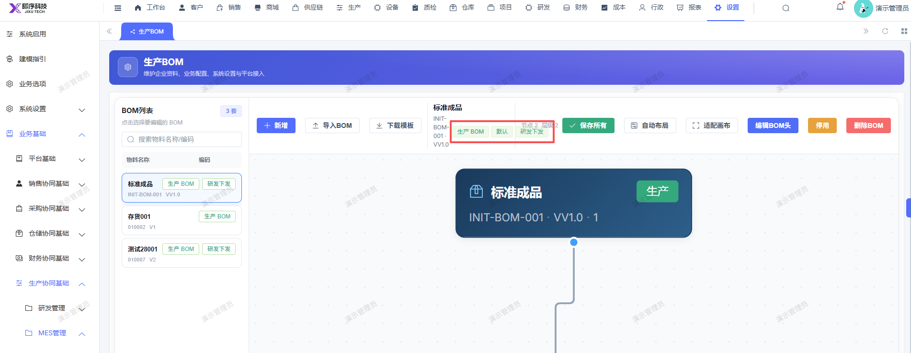

# 生产bom页面的，存货名称栏的：生产bom 默认 研发下发 展示重叠

- **优先级**：P2
- **模块 / 页面**：设置-业务基础-生产协同基础
- **测试环境**：https://jixu-ai.com/settings/production/bom
- **提交时间**：2026-11-10 11:30:08（北京时间）
- **状态**：待修复

## 问题描述
生产bom页面的，存货名称栏的：生产bom 默认 研发下发 展示重叠

## 复现步骤
1，点击设置
2，点击业务基础
3，点击生产协同基础
4，点击mes管理
5，点击生产bom，点击存货：测试28001，存货名称栏的：生产bom 默认 研发下发 展示重叠

## 实际结果

## 预期结果

## 截图

