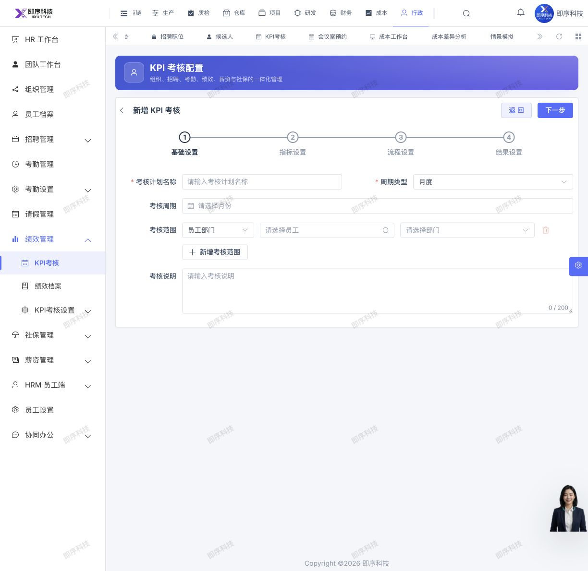

# Codex 生产浏览器走查报告

## 基线与边界

- 执行者：Codex，接替 Muse 使用生产浏览器继续测试。
- 时间：2026-10-11 10:15 至 10:27，Asia/Shanghai。
- 环境：`https://jixu-ai.com`；沿用已登录会话，顶部显示“即序科技”，未重新注册、登录或改变权限。
- 后端：只读 SSH 核对 `root@aliCfor`，服务 `spring_cfor-server-4.service` 为 active，`48083` 健康检查返回 UP。
- 实际 JAR：`/www/server/jixu-ai/releases/standard-20261011070543-bug44-50fba370/cfor-server-4.jar`。
- 前端证据：浏览器加载主资源 `/assets/index-9OHH3eyu.js`，KPI 表单资源 `/assets/index-BiycKUTE.js`。没有仅凭本地源码 HEAD 认定生产版本。
- 未保存、审核、弃审、删除、上传、计算工资、创建工资表或修改配置；未执行直接数据库写入、构建、部署或服务重启。
- 已加载的页面可能自动执行自身初始化请求；本轮没有审计所有查询接口的内部副作用，不据此声称数据库绝对零变化。

## 新增问题

### Bug 51：KPI 新增页返回失效

列表 → 新增 → 点击“返回”，URL 仍为 `/hrm/performance/plan/form?type=create`，内容仍为“新增 KPI 考核”；新增页签已被移除。两次复现。

控制台错误时间及摘要：

```text
2026-10-11T02:19:34.971Z
2026-10-11T02:21:46.205Z
Vue error: Error
  at router resolve / push
  at h (.../assets/index-BiycKUTE.js:1:8425)
  info: runtime-6
```

代码线索：`src/views/hrm/performance/plan/form/index.vue` 的 `close()` 删除页签后跳转命名路由 `HrmPerformancePlan`；列表为动态菜单，当前静态路由没有声明这个列表名称。最终根因仍应在修复时结合动态路由核实。



状态：待修复，未发布。保存成功后是否同样失败未测试。

## 实际覆盖

“可打开”仅说明页面或表单展示成功，不代表保存、审核、权限隔离及上下游流转已通过。

| 范围 | 实际操作 | 本轮结果 |
| --- | --- | --- |
| 工作台、HR 工作台 | 导航与读取 | 可展示，收尾回到 `/index` |
| 招聘职位 `/hrm/recruit/post` | 列表、新增表单、取消 | 可打开，职位编码、名称、人数等字段可见；未保存 |
| 候选人 `/hrm/recruit/candidate` | 列表、登记表单、取消 | 可打开，职位/渠道选择器存在；无在招职位时未强行登记 |
| KPI `/hrm/performance/plan` | 列表、新增、返回、再次复现 | 新增可打开，返回失败，见 Bug 51 |
| 会议室预约 `/oa/reservation/meeting-room` | 列表、新增表单、取消 | 可打开，默认开始/结束为当日 11:00/12:00；未提交预约 |
| 任务管理 `/oa/task/list` | 列表、新增表单、取消 | 可打开，任务类型/状态/接收人与日期字段可见；未创建任务 |
| 成本工作台 `/cost-management/workbench` | 查看 | 正常显示模型未初始化；未初始化或执行核算 |
| 成本差异 `/cost-management/analysis/cost-comparison` | 查看 | 显示未发布的试算预览，正式导出禁用；未把空数据判为故障 |
| 情景模拟 `/cost-management/analysis/scenario` | 查看 | 空列表，页面标注演示数据和正式写入禁用；未执行模拟 |
| 出入库明细 `/database/reportForm/queryInOutDetail` | 查看 | 可显示 5 条历史明细；未下钻写入或导出 |
| 客户余额表 | 查看、搜索 | 可显示 4 条记录，搜索接口返回成功；未核对账务完整性 |
| 供应商余额 `/database/reportForm/supplier-balance` | 查看 | 可显示 4 条记录；金额观察见下一节 |
| 生产统计表 | 查看、查询 | 正常空态；工单列表和数量/产值/交期统计请求返回成功 |
| 报工统计、质量分析、领料明细、任务统计 | 逐页导航并读取 | 页面可展示空态；未验证有数据时的统计正确性 |
| 月度工资 `/hrm/salary/month-record` | 只读查看 | 当前周期 2026-10，0 人；相关加载请求 code=0；未核算、编辑或创建下月表 |
| 社保表 `/hrm/insurance/month-record` | 只读查看 | 年份 2026，正常空态；last/list 请求 code=0；未新建首月表 |

## API 取证

通过浏览器 CDP 被动读取页面自然请求，不另行构造接口调用，也不读取或导出 token、密码和密钥。

| 页面请求 | HTTP | 业务响应 |
| --- | --- | --- |
| `/hrm/performance/plan/page`、`status-count` | 200 | 页面正常空态，未凭 HTTP 单独判通过 |
| `/finance/finReceivable/settlement` | 200 | code=200，旧响应协议成功码 |
| `/finance/finPayable/settlement` | 200 | code=200，旧响应协议成功码 |
| `/mes/stkView/stkDetailsList/dictText` | 200 | code=200 |
| `/mes/prodWork/list/dictText` | 200 | code=200 |
| `/mes/prodWork/orderValueStatistics`、`prodValueStatistics`、`qtyStatistics`、`deliveryStatistics` | 200 | code=200 |
| `/hrm/salary/month-record/last`、`option-summary`、`payroll-readiness` | 200 | code=0 |
| `/hrm/salary/month-employee-record/page`、`change-count` | 200 | code=0 |
| `/hrm/insurance/month-record/last`、`list` | 200 | code=0 |

没有把旧接口的 `code=200` 误判为业务错误，也没有把返回成功等同于端到端业务通过。

## 关联观察与未验证

- 供应商余额表显示 `ZC-1010-供应商002` 的总金额 `0`、已核销 `100`、未核销 `-100`；可能与 Bug 20 未生成应付事实相关。负余额也可能涉及预付口径，尚未核对，不能直接认定错误或调整数据。
- 客户余额与供应商余额均展示 4 条客商；未核对是否属于双角色客商，不仅凭名称登记过滤问题。
- 本轮未重新验证既有 Bug 12、14、15、27、37、49、50，不改变它们的状态。
- 未覆盖保存、审批、过账、库存扣减、财务核算、新租户初始化及不同账号权限。上述层级仍待受控环境或后续明确授权测试。

## 配置保护

10:15 与 10:27 的只读核对一致：

```text
jixu-ai.env
65ab73b587c006f4b8df97c2cac16cede872f91eee33315f182c1569c853a1d4

frontend-config.json
bf176169574fde57761bcc3c12b0f24a9ff373a41477ad9ae07330ada651f800
```

没有读取明文密钥，也没有把生产配置内容写入报告或 Git。
