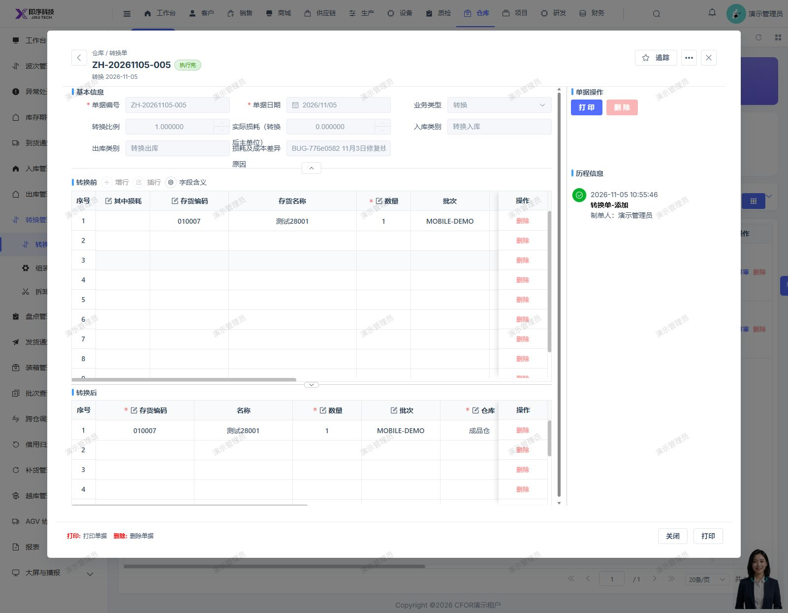
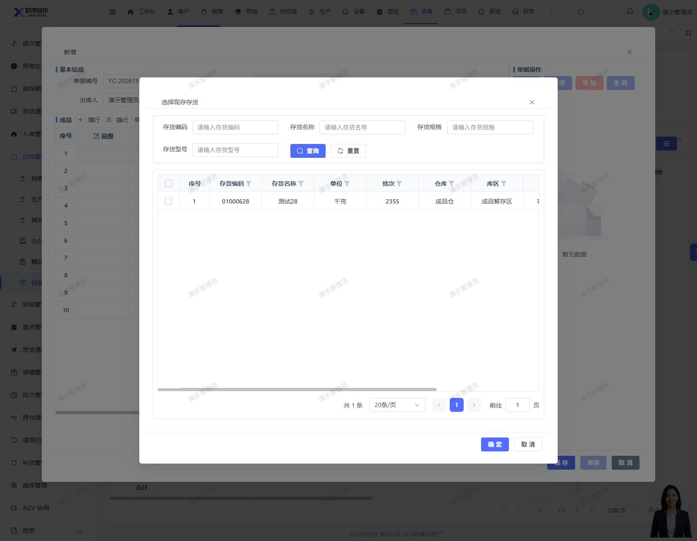
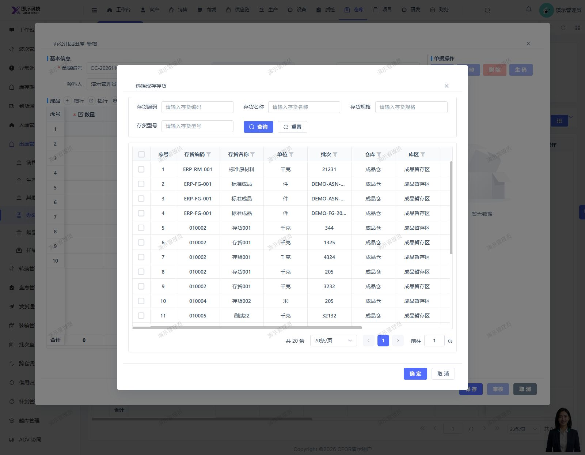
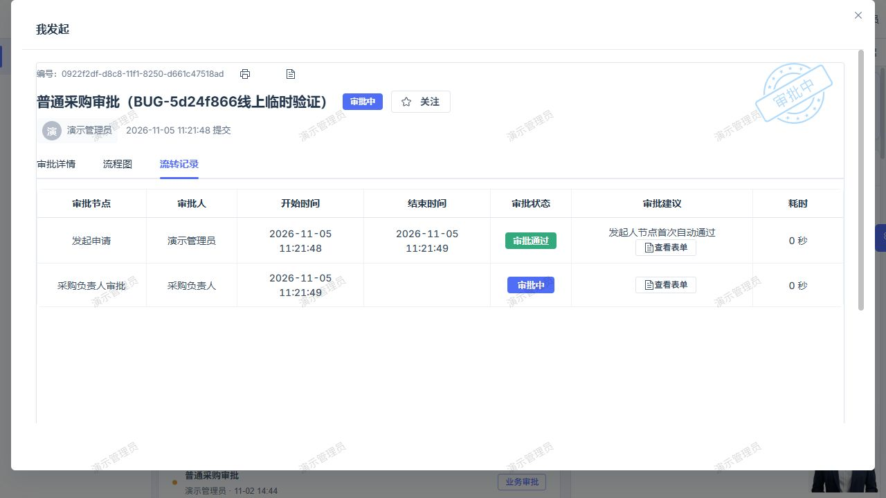

# 已合并 Bug 修复记录（2026-11-06）

记录人：Codex。时区：Asia/Shanghai。按用户本次要求补登记 10 项已合并修复，关联 11 个前后端提交；本次工作仅更新 Bug 仓库。

修复提交已由用户确认合入 dev/develop_5.0.1；远端分支头只读查询为前端 5e339dba28d67ed857d1b3b3ee33b1bb9647d386、后端 88672ba8f500671a121d47dc6a648413e66f14b0。本地旧远端引用不作为未合并证据。GitLab 提交链接需要相应内网访问权限。

状态汇总：4 项按 2026-11-05 已完成的生产浏览器复测记录登记已验证；6 项登记代码已修复、待发布。没有生产发布证据的条目不因合并而升级。所有已验证结论限定于下述实际测试场景，不代表全部业务链路或所有租户通过。

## 检查及资料边界

- 本次核对实际 Git 提交、既有逐项本地修复记录及 2026-11-05 线上复测记录，不把本次文档同步表述为重新执行全部测试。
- 历史 Java 检查使用 Java 17 定向编译和 JUnit；完整 Maven 检查曾受既有 ERP 依赖/API 编译问题阻塞。前端全量类型检查曾因 Node 堆内存耗尽未完成，不登记为全量检查通过。
- 4 张线上截图经本次检查，为演示租户业务页面，不含凭据；只上传对应验收截图，不上传原始数据库导出、连接配置或运行参数。
- 保留原始报告及截图。本次不调整其他 Bug、产品源码、主线程未提交修复、线上配置或业务数据。

## BUG-local-20261102171621-776e0582

**问题**：转换单临时行编号导致保存失败。

- 原报告：[BUG-local-20261102171621-776e0582](../BUG-local-20261102171621-776e0582.md)
- 当前状态：已验证（线上新增保存及重新读取场景通过）
- 产品提交：[前端 d2ec615f2](http://192.168.110.240:3008/cfor_front/cfor-admin-vue3/-/commit/d2ec615f2af1a6051107522783266a72f0da6ab0)
- 合入分支：dev/develop_5.0.1

**原因**：保存时删除表格原行编号触发表格重载，临时行编号又进入保存请求，造成明细写入失败。

**修复**：复制转换前后明细，仅清理请求副本中的行编号和表格临时标识，保留页面原行及来源业务标识。未修复另行排除的部门空指针。

**本地验证**：本地新增 ZH-20261103-004 保存成功，关闭后重开正确回读；真实保存函数的新增、编辑、失败重试及校验拦截 4 项回归通过。页面编辑保存受后置单据限制未完成。

**生产复测（Codex，2026-11-05）**：Codex 于 2026-11-05 在 jixu-ai.com 演示租户实际新增 ZH-20261105-005，保存成功并按现有配置自动执行；重开后转换前后明细、数量、批次、库位、比例和零损耗正确回读。未覆盖编辑、弃审或损耗分支。

## BUG-local-20261102171125-01e28e7d

**问题**：样品出库混入非样品来源库存。

- 原报告：[BUG-local-20261102171125-01e28e7d](../BUG-local-20261102171125-01e28e7d.md)
- 当前状态：已验证（线上来源筛选及选货回填场景通过）
- 产品提交：[前端 457e456c2](http://192.168.110.240:3008/cfor_front/cfor-admin-vue3/-/commit/457e456c265bea4c5ba4465356b3bacf6d5d37d3)、[后端 98c79b6ab](http://192.168.110.240:3008/cfor_backend/cfor-admin/-/commit/98c79b6ab067e1a853018d7e5fdb54dc92db674b)
- 合入分支：dev/develop_5.0.1

**原因**：选货接口只限制正库存，没有限定样品入库来源。

**修复**：样品出库传入专用筛选参数；后端按有效样品入库来源、租户及完整库存维度匹配正库存，以 EXISTS 避免重复，并兼容历史空维度。

**本地验证**：本地普通库存被排除；新增并审核样品入库后，仅样品批次可选且回填正确。6 项 SQL 行为回归通过，覆盖有效来源、无效及跨租户来源、完整维度、历史空值、零库存等。

**生产复测（Codex，2026-11-05）**：Codex 于 2026-11-05 在演示租户对照普通选货 20 条，样品选货仅返回 01000628 / 批次 2355 / 100 千克，并与样品入库来源匹配；选中后物料及仓储信息正常回填。表单取消，未保存、审核或扣减库存；未覆盖全部历史维度边界。

## BUG-local-20261102164509-47cb2a25

**问题**：办公用品出库无法选择存货。

- 原报告：[BUG-local-20261102164509-47cb2a25](../BUG-local-20261102164509-47cb2a25.md)
- 当前状态：已验证（线上两个选货入口及回填场景通过）
- 产品提交：[前端 2d34b6af8](http://192.168.110.240:3008/cfor_front/cfor-admin-vue3/-/commit/2d34b6af81012102500768d4ff5920949239217d)
- 合入分支：dev/develop_5.0.1

**原因**：表单缺少现存存货选择入口和对应回填处理，批次点击无法完成选货。

**修复**：为批次及存货编码接入现存存货选择，回填物料、数量和仓储维度，保留数量限制。

**本地验证**：两个入口可打开选择器；选货、数量上限、保存以及重新打开已在本地页面验证。改动限定为单个表单文件。

**生产复测（Codex，2026-11-05）**：Codex 于 2026-11-05 在演示租户分别从批次和存货编码打开选择器，选中 ERP-FG-001 / DEMO-ASN-002，数量及仓储信息正确回填。编码列需横向滚动后操作；新增表单取消，未保存、审核或扣减库存。

## BUG-local-20261102144759-5d24f866

**问题**：有效兜底审批人已配置但任务仍留给发起人。

- 原报告：[BUG-local-20261102144759-5d24f866](../BUG-local-20261102144759-5d24f866.md)
- 当前状态：已验证（有效其他兜底人场景线上转交通过；原流程配置与历史待办仍需处理）
- 产品提交：[后端 cad8b81cd](http://192.168.110.240:3008/cfor_backend/cfor-admin/-/commit/cad8b81cd79e5f897513b28f1d14cb6d8db3f763)
- 合入分支：dev/develop_5.0.1

**原因**：原报告包含缺少其他有效审批人的配置问题；进一步配置有效兜底人后，发现事务完成回调中的转交缺少独立事务，可能留下转交记录却未持久化负责人。

**修复**：为兜底转交及回调自动审批提供经 Spring 代理调用的独立事务入口，转交记录与任务更新原子提交或回滚；保留禁止自审策略。

**本地验证**：采购负责人、财务复核及负责人终审实际通过，流程结束并正确回写订单；审批分派及策略定向回归 14 项通过。

**生产复测（Codex，2026-11-05）**：Codex 于 2026-11-05 在用户授权的临时普通采购流程中，新建 CG-20261105-002，任务自动转交采购负责人并持久化，发起人无通过按钮。原流程已恢复、临时版本停用、测试实例取消且无运行任务。运行包已核对独立事务注解特征。仅验证新实例转交，未验证线上后续审批全链。原 V1 仍只有发起人作为管理员，缺少有效其他兜底人；历史失败待办未迁移，仍须单独处理正式配置及历史实例。

## BUG-local-20261102143611-10597054

**问题**：手工审核采购订单后入库误报未审核。

- 原报告：[BUG-local-20261102143611-10597054](../BUG-local-20261102143611-10597054.md)
- 当前状态：代码已修复，待发布
- 产品提交：[后端 84eed0eca](http://192.168.110.240:3008/cfor_backend/cfor-admin/-/commit/84eed0ecaa4377fa49f63cf83d8ef11780f797c3)
- 合入分支：dev/develop_5.0.1

**原因**：未开启自动执行时，手工核批更新单据阶段及生效标记，但 ERP 审核状态未同步。

**修复**：订单审核生效即同步审核状态；未执行且通过后置单据检查的订单弃审时恢复未提交状态。不批量修正已有异常订单。

**本地验证**：采购单审核、弃审、再审核通过，下游入库不再报订单未审核，进入后续质检门禁；14 项定向测试通过，原代码同测有 3 项失败。本项测试没有独立完成全部入库流程。

**生产状态**：本次没有核实该修复的生产发布及业务复测证据，保持代码已修复、待发布。

## BUG-local-20261027113441-8cac0bc3

**问题**：采购入库无需质检仍被审核拦截。

- 原报告：[BUG-local-20261027113441-8cac0bc3](../BUG-local-20261027113441-8cac0bc3.md)
- 当前状态：代码已修复，待发布
- 产品提交：[后端 4c1d68142](http://192.168.110.240:3008/cfor_backend/cfor-admin/-/commit/4c1d6814245dbca5e07aae1926a8e4038ac301f1)
- 合入分支：dev/develop_5.0.1

**原因**：采购入库按主单是否已质检直接拦截，没有先判断明细是否要求质检。

**修复**：仅在存在需检明细时检查主单已质检标记；保留历史质检回写补偿和需检未完成拦截，反向回写跳过正向门禁，无需质检时不伪造已质检标记。

**本地验证**：CR-20261104-003 在明细无需质检、主单未质检时审核生效并回写订单，阶段执行中。新增 10 项回归通过；相关 56 项通过。扩大检查 71 项中有 4 项既有质量回写失败，原代码也有同样失败，未记为全部通过；现场后续上架未验证。

**生产状态**：本次没有核实该修复的生产发布及业务复测证据，保持代码已修复、待发布。

## BUG-local-20261104162244-5a8ffe15

**问题**：客户价格表保存回写只读客户视图失败。

- 原报告：[BUG-local-20261104162244-5a8ffe15](../BUG-local-20261104162244-5a8ffe15.md)
- 当前状态：代码已修复，待发布
- 产品提交：[后端 49e256613](http://192.168.110.240:3008/cfor_backend/cfor-admin/-/commit/49e25661387097402dd74db266d31aaa6bc0aa7d)
- 合入分支：dev/develop_5.0.1

**原因**：客户档案迁移为统一客商后，客户价格表仍向旧客户只读兼容视图更新协议标记，事务失败回滚。

**修复**：改用统一客商 Mapper 读取并仅回写协议标记，保留身份校验、原有判定规则及事务，避免覆盖其他客商字段。

**本地验证**：真实页面新增、编辑及删除通过，数据库只读确认价格和协议标记变化且其余档案字段保留；测试草稿正常软删除，未启用测试价格。Java 17 定向编译及 6 项回归通过。

**生产状态**：本次没有核实该修复的生产发布及业务复测证据，保持代码已修复、待发布。

## BUG-local-20261104161700-f88973d0

**问题**：客户排行榜图例与客户名称重叠。

- 原报告：[BUG-local-20261104161700-f88973d0](../BUG-local-20261104161700-f88973d0.md)
- 当前状态：代码已修复，待发布
- 产品提交：[前端 993251194](http://192.168.110.240:3008/cfor_front/cfor-admin-vue3/-/commit/993251194f3f2594be7d86a7502beb9b33ffa407)
- 合入分支：dev/develop_5.0.1

**原因**：图例与倾斜客户名称都位于图表底部，占用同一区域。

**修复**：将图例移至顶部居中，保留图表数据、尺寸和客户名称展示规则。

**本地验证**：本地页面刷新及重置后图例与客户名称分离、销售数量和金额正确。定向 ESLint 0 错误、2 条原有警告，Sass 编译及差异检查通过。修复前线上只读检查仍重叠，不作为修复后的线上通过证据。

**生产状态**：本次没有核实该修复的生产发布及业务复测证据，保持代码已修复、待发布。

## BUG-local-20261104145151-f6441698

**问题**：销售发票号不显示及按号码查询无结果。

- 原报告：[BUG-local-20261104145151-f6441698](../BUG-local-20261104145151-f6441698.md)
- 当前状态：代码已修复，待发布
- 产品提交：[前端 f0244ed70](http://192.168.110.240:3008/cfor_front/cfor-admin-vue3/-/commit/f0244ed7019feb1c49c6423b938a88fc7b53023c)
- 合入分支：dev/develop_5.0.1

**原因**：表单将发票号保存为 accountNumber，列表展示及查询使用 billNo，导致未编号及查询无结果。

**修复**：统一发票号列、编号组件、查询和重置字段为 accountNumber，沿用后端已有查询能力；仅修改该页面 6 行。

**本地验证**：默认列表、完整发票号查询、无匹配空结果、重置及点击号码打开只读详情通过；定向 ESLint 与差异检查通过。全项目类型检查因 Node 堆内存耗尽未完成。

**生产状态**：本次没有核实该修复的生产发布及业务复测证据，保持代码已修复、待发布。

## BUG-local-20261104113954-526ff1b9

**问题**：出入库流水销售退货单号无法查看详情。

- 原报告：[BUG-local-20261104113954-526ff1b9](../BUG-local-20261104113954-526ff1b9.md)
- 当前状态：代码已修复，待发布
- 产品提交：[前端 241a8c6e8](http://192.168.110.240:3008/cfor_front/cfor-admin-vue3/-/commit/241a8c6e8d6c179afb2089dd5260843982ad5628)
- 合入分支：dev/develop_5.0.1

**原因**：流水页面未处理销售退货入库类型 302，点击单号被静默跳过。另有销售退货字典配置遗漏，属于独立配置问题。

**修复**：补齐销售退货详情入口，按来源单 ID 和单号打开已有弹窗并传入只读标志，缺少来源单时提示；只保留 9 行入口修复，无迁移脚本或页面名称兜底。

**本地验证**：点击流水打开正确销售退货只读详情，关闭后重复打开通过；采购入库及销售出库入口回归正常。定向 ESLint 与差异检查通过，全项目类型检查因 Node 堆内存耗尽未完成。

**生产状态**：本次没有核实该修复的生产发布及业务复测证据，保持代码已修复、待发布。

2026-11-05 已按用户授权通过本地及线上字典页面补齐 stock_io_type 的 302、bill_type 的 MesStkIo:302，标签均为销售退货且启用；原 SalReturn 保留。线上名称显示及类型查询已核对，此配置不随 Git 提交分发，不能据此声称详情入口代码已在生产验证。

## 既有线上验收数据及范围

- 转换单 ZH-20261105-005 为当时授权测试，前后同物料、同批次、同库位、等量、损耗 0，保存后按原配置自动执行；单据保留供核对。
- 样品出库及办公用品出库新增表单均已取消，未保存、审核或扣减库存。
- 兜底审批在当时用户授权的临时流程中验证，临时版本启用约 29 秒，仅产生本次测试实例；原版本已恢复、临时版停用、测试实例取消，无运行待办，未付款或入库。原流程缺少其他有效兜底人的配置及历史待办没有被此次代码修复自动处理。
- 本次不重新登录线上、不重复这些业务操作。
